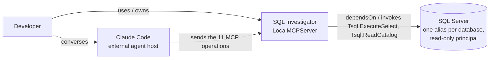

# System context (editorial)

Solid arrows are declared in `model/architecture.adl`: `Developer uses ::SQLInvestigator`, `Developer owns Investigation`, `ClaudeCode sends` the 11 MCP messages, and the services' `dependsOn` / `invokes` edges to `SQLServer`. The dashed Developer → Claude Code arrow is **not** declared: ADL 1.6 has no Actor → ExternalSystem relationship, so the conversation is stated only in the element descriptions.

The verified, generated version of this view is `atlas/c1-context.svg`.
