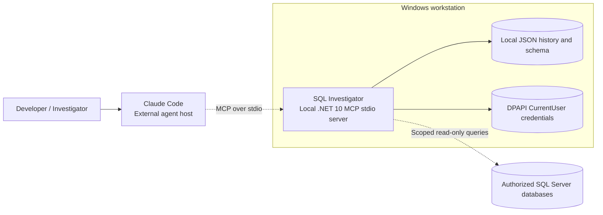

# System context

**Evidence:** Developer, Claude Code, SQL Server, LocalMCPServer, InvestigationHistory and CredentialVault are modeled. Connection routes are described in ADL/Vision, not explicitly declared as relationship edges.
