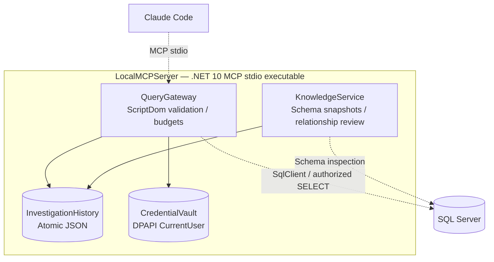

# Local runtime — provisional component allocation

**Modeling gap:** QueryGateway and KnowledgeService are declared Services; LocalMCPServer is a declared Deployable. Their placement inside that deployable is a **design intent**, not yet supported by `deployedAs` relationships. Correct ADL before treating this as a mechanically proven C2/C3 diagram.
