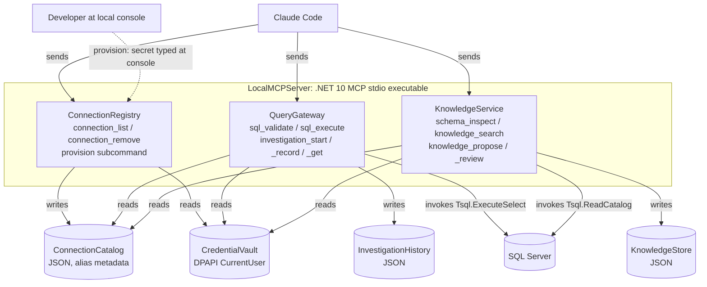

# Local runtime: component allocation (editorial)

Every solid arrow and the placement of all three services inside `LocalMCPServer` (`deployedAs`) is declared in the ADL. Each JSON store has exactly one writer.

The dashed arrow is **not** a declared relationship. `ProvisionConnection` has no declared sender: ADL has no edge from an Actor to a Command. The provisioning console is also how the DPAPI secret reaches `CredentialVault`, which ADL forbids any service to `write` (`adl/architectural/secret-store-write`).

The verified, generated views are `atlas/c2-containers.svg` and `atlas/c3-components.svg`.
