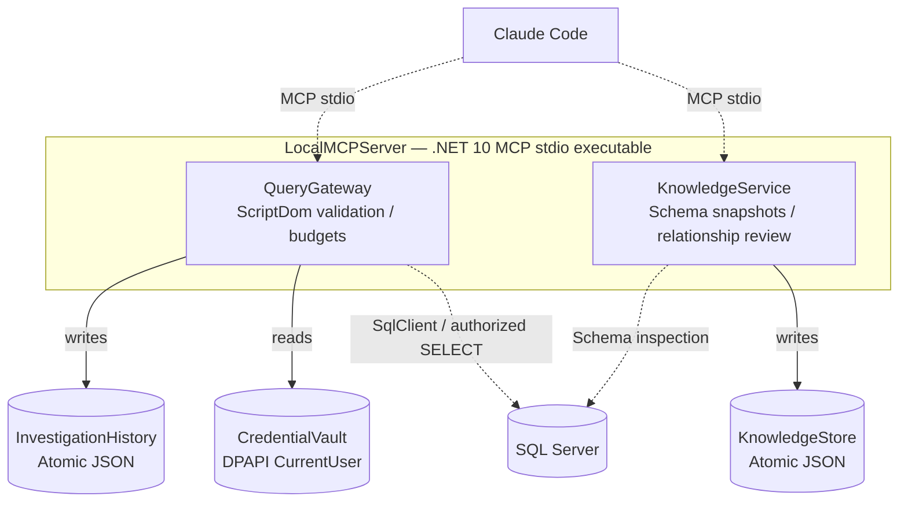

# Local runtime — component allocation

Solid arrows and the placement of both services inside `LocalMCPServer` are declared in the ADL (`writes`, `reads`, `deployedAs`). Dashed arrows are intended integrations the model does not declare.
