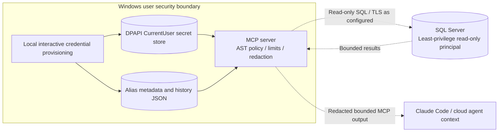

# Security and data boundaries

**Trust caveat:** Redaction and query limits do not automatically make database content safe to send to a cloud model. Obtain explicit employer/data-owner authorization for each dataset before connecting production systems. Credentials are provisioned locally, never through the chat or MCP tool arguments.
