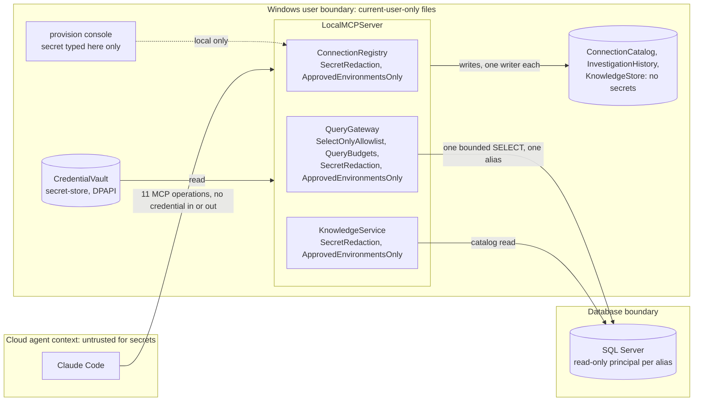

# Security and trust boundaries (editorial)

Declared in the model:
- `constrainedBy` guardrails on every service: SelectOnlyAllowlist, QueryBudgets, SecretRedaction, ApprovedEnvironmentsOnly.
- `governedBy: ProductionDataApproval` on every service.
- `CredentialVault` as a `secret-store` that no service writes.
- Requirements `LocalOnlyProvisioning`, `NoSecretDisclosure` and `ReadOnly`.

**Not declared:** the boundary boxes themselves (ADL declares the system/outside divide, not zones) and the dashed console arrow.

**Trust caveat:** redaction and budgets do not make database content safe to send to a cloud model. The data owner must approve the data classifications and environment before any non-fixture database is connected (BDL `SensitiveDataPolicy` is open).

The verified, generated version of this view is `atlas/security-boundaries.svg`.
